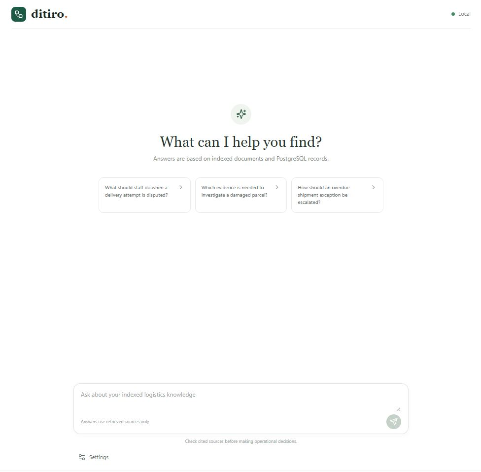
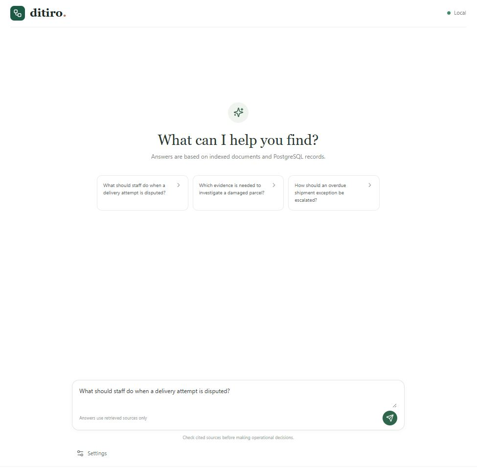
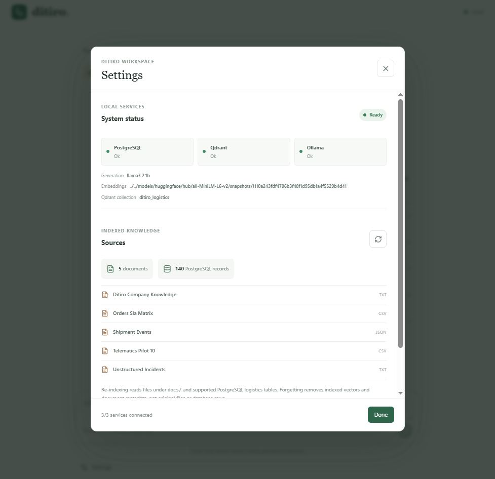
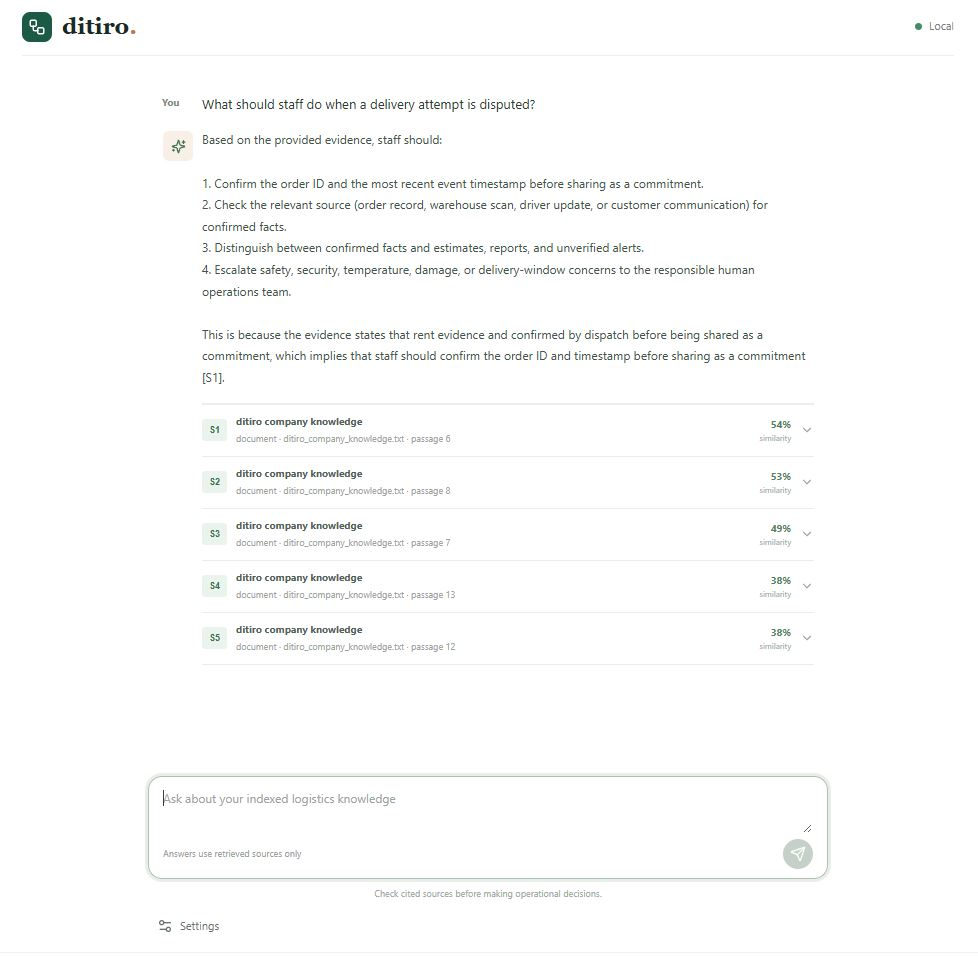

# Ditiro: Logistics Intelligence & Multi-Agent RAG Platform

Ditiro is a proposed modular logistics intelligence platform designed to help courier companies, freight operators, fleet managers, warehouses, and distribution teams resolve operational problems using reliable evidence, connected information, and measurable workflows.

The platform aims to bridge the logistics chain without requiring every organization to replace its existing transport management system (TMS), warehouse management system (WMS), courier software, fleet systems, or financial applications.

Its initial capability is evidence-grounded information retrieval. Over time, validated use cases may justify adding exception management, workflow automation, controlled tool execution, and specialized AI agents.

**The objective is not to build AI for its own sake. It is to reduce avoidable operational delays, improve accountability, and demonstrate measurable business value.**

---

## 1. The Business Problem

Logistics operations depend on coordinated actions across customers, drivers, depots, dispatchers, warehouses, customer service, finance, and external carriers. Relevant information is often distributed across operational databases, tracking systems, documents, communications, and individual teams.

When information is incomplete, inconsistent, or difficult to access, employees may struggle to determine what happened, who should act next, and whether a problem has actually been resolved.

Anonymized customer reviews used during initial discovery describe recurring problems such as:

- **Unreliable shipment visibility:** tracking information that does not reflect the actual shipment situation, missing scans, contradictory statuses, and potentially inaccurate delivery-attempt records.
- **Unresolved delivery exceptions:** delayed parcels, failed collections, unsuccessful returns, unclear ownership, and cases that remain unresolved for extended periods.
- **Poor communication and handoffs:** missed callbacks, repeated customer contacts, inadequate explanations, and difficulty obtaining information from other departments.
- **Weak chain of custody:** lost or damaged parcels, disputed proof of delivery, missing verification evidence, and inadequate investigation records.
- **Billing and claims disputes:** unexpected charges, disputed parcel measurements, delayed refunds, and stalled loss or damage investigations.
- **Inconsistent operational performance:** differences between routes, branches, services, and teams that make it difficult to identify what works and where intervention is needed.

These reviews provide qualitative problem signals, not independently verified operational data. They do not establish how frequently these failures occur, why they occur, or how much they cost.

Ditiro must validate these problems with prospective customers before treating any particular cause or solution as established.

### The initial problem hypothesis

Courier staff may spend excessive time investigating shipment exceptions because relevant evidence is fragmented, event histories are difficult to reconcile, ownership is unclear, and follow-up is inconsistent.

The first discovery objective is to determine whether these conditions exist in a real customer workflow, identify which barriers software can address, and establish a measurable baseline.

Software cannot independently correct insufficient staffing, inadequate depot capacity, unsafe driving, damaged infrastructure, or poor management practices. It can improve visibility, coordination, evidence quality, and accountability where those are contributing factors.

---

## 2. Product Vision and Scope

Ditiro is intended to become a modular platform that connects information and workflows across the logistics chain.

Potential modules include:

| Module | Business purpose |
|---|---|
| Logistics knowledge and search | Find relevant procedures, shipment records, and operational documents with source references. |
| Shipment visibility | Consolidate shipment events from authorized systems and distinguish reported from verified states. |
| Exception management | Record, assign, investigate, escalate, and verify the resolution of operational exceptions. |
| Delivery and collection operations | Support failed deliveries, collection scheduling, returns, and follow-up workflows. |
| Proof of delivery and custody | Improve access to delivery evidence, handling history, and investigation records. |
| Customer service | Help staff answer enquiries using current, authorized evidence and track promised callbacks. |
| Billing and pricing assurance | Investigate discrepancies between quoted, measured, and charged amounts. |
| Refunds and claims | Organize evidence, monitor outstanding cases, and support accountable decisions. |
| Fleet and safety incidents | Consolidate relevant incident information and support authorized investigation workflows. |
| Operational analytics | Measure exception volumes, resolution times, backlog, rework, and service performance. |

These modules represent a potential product direction, not a commitment to build them all.

### Initial release boundary

The first release should focus on a single validated user group and workflow.

The provisional starting point is **courier operations staff investigating shipment exceptions using synthetic documents and PostgreSQL records**.

The first release should demonstrate that users can retrieve relevant evidence, understand its provenance, identify uncertainty or conflicting information, and use that information to support an investigation.

It must not autonomously change shipment statuses, issue refunds, reject claims, contact customers, or declare a real-world exception resolved.

Operational integrations and automated actions should be introduced only when discovery establishes a genuine need, suitable access is available, and the associated risks can be controlled.

---

## 3. FDE Operating Model

Ditiro will follow a Forward Deployed Engineering lifecycle:

**Discover → Design → Build → Deploy → Prove → Scale & Productize**

Each phase has explicit deliverables and exit criteria. Completing code is not equivalent to delivering business value.

### Phase 1: Discover

**Objective:** Establish the actual business problem before choosing a solution.

Activities:

- Identify the target customer, sponsor, users, and stakeholders.
- Observe how staff investigate and resolve a recent exception.
- Map the current workflow across people, systems, and handoffs.
- Identify existing software, manual workarounds, and non-software alternatives.
- Establish the authoritative source for each relevant data field.
- Assess data availability, quality, freshness, access restrictions, and integration feasibility.
- Identify privacy, security, and operational constraints.
- Define baseline metrics and a credible method of measurement.
- Determine whether the primary barriers are informational, procedural, technical, or operational.

Deliverables:

- Problem brief.
- Current-state workflow map.
- Evidence and data inventory.
- Root-cause hypotheses and supporting or contradictory evidence.
- Baseline measurement plan.
- Opportunity and feasibility assessment.

**Exit criteria:** A prospective customer confirms a consequential problem; the current workflow is sufficiently understood; evidence and access constraints are documented; and the customer agrees on how success will be measured.

If these conditions are not met, continue discovery or reject the opportunity. Do not move directly to implementation because the proposed technology appears interesting.

### Phase 2: Design

**Objective:** Specify the smallest credible solution to the validated problem.

Activities:

- Compare process improvements, existing software, deterministic automation, integrations, and AI.
- Define MVP scope, non-goals, acceptance criteria, and measurable targets.
- Establish system boundaries, data ownership, API contracts, and access controls.
- Design failure handling, observability, security, and recovery.
- Determine whether vector search, agents, or external integrations are actually required.

Deliverables:

- Proposed architecture and decision records.
- Data model and interface contracts.
- Workflow and authorization specifications.
- Test and evaluation plan.
- Deployment and rollback plan.
- Pilot charter with success criteria.

**Exit criteria:** The proposed design addresses the validated root cause, its dependencies are understood, its risks are acceptable, and the implementation can be evaluated against agreed criteria.

### Phase 3: Build

**Objective:** Implement the smallest testable increment that satisfies the design.

Activities:

- Develop the selected workflow and its domain logic.
- Implement ingestion, retrieval, and evidence provenance where required.
- Add authentication, authorization, tenant boundaries, and auditability.
- Test business logic, APIs, integrations, failure paths, and retrieval quality.
- Validate the system against realistic synthetic scenarios.

**Exit criteria:** The implementation meets defined acceptance criteria, relevant tests pass, known limitations are documented, and the pilot environment is ready for deployment.

### Phase 4: Deploy

**Objective:** Introduce the solution into a controlled environment.

Activities:

- Configure the environment and secrets securely.
- Establish logging, monitoring, backups, and recovery procedures.
- Validate permissions and data access.
- Train pilot users and document operational procedures.
- Define rollback conditions and ownership of incidents.

**Exit criteria:** The system operates in the intended environment, critical workflows have been verified, monitoring is available, and operational ownership is established.

### Phase 5: Prove

**Objective:** Determine whether the solution produces measurable customer value.

Activities:

- Compare results against the baseline.
- Measure task completion, resolution time, handling effort, errors, and user adoption as appropriate.
- Investigate unexpected outcomes and failure modes.
- Collect feedback from frontline staff and management.
- Separate measured improvements from assumptions and external factors.

**Exit criteria:** Evidence demonstrates whether the agreed targets were met. If the system does not deliver value, investigate, revise, or stop rather than expanding automatically.

### Phase 6: Scale & Productize

**Objective:** Reuse validated capabilities without assuming every logistics business operates identically.

Activities:

- Identify common workflows across customers.
- Separate reusable platform capabilities from customer-specific integrations.
- Improve configuration, tenancy, integration adapters, deployment automation, and documentation.
- Reassess reliability, support costs, security, and commercial viability.
- Expand into additional logistics modules only when customer evidence justifies doing so.

**Exit criteria:** The capability is repeatable, supportable, commercially justified, and reliable across its intended operating conditions.

---

## 4. Architecture Principles

Ditiro should begin as a modular monolith with clear internal boundaries. Separate services should be introduced only when independently scaling, deployment, reliability, or ownership requirements justify their additional complexity.

The application has five principal responsibilities:

1. **Operational data:** Authoritative structured records and business rules.
2. **Knowledge retrieval:** Searchable document content with provenance and access controls.
3. **Workflow orchestration:** Explicit processes, state transitions, deadlines, and error handling.
4. **AI assistance:** Evidence-grounded investigation, summarization, and recommendations.
5. **User experience and measurement:** Interfaces that help staff act effectively and demonstrate outcomes.

### Proposed architecture

```text
                     Logistics Users
                           |
                Next.js + TypeScript
                    + Tailwind CSS
                           |
                     FastAPI Backend
                           |
             Authentication and Authorization
                           |
                 Domain and Workflow Layer
                           |
             +-------------+-------------+
             |             |             |
       Operational      Knowledge     Audit and
       Data Access      Retrieval    Observability
             |             |             |
        PostgreSQL       Qdrant       PostgreSQL
             |             |
             |        Embedding Model
             |             |
             |        Source Documents
             |
      Approved Integrations
      TMS / WMS / Carrier /
      Fleet / Finance Systems

              Optional Supporting Services
               Redis / Background Workers
               Ollama / LLM Orchestration
```

The diagram describes logical responsibilities, not a requirement to deploy each component as an independent service.

### Initial technology choices

| Component | Proposed technology | Purpose |
|---|---|---|
| Frontend | Next.js, React, TypeScript, Tailwind CSS | Operational interface |
| API | Python, FastAPI, Pydantic | Validated API contracts and backend orchestration |
| Operational database | PostgreSQL | Structured records, permissions, workflow state, and audit data |
| Vector database | Qdrant | Semantic retrieval over approved document chunks |
| LLM runtime | Ollama | Local model inference during development |
| Embeddings | SentenceTransformers | Embed local documents, PostgreSQL records, and questions |
| Containers | Docker and Docker Compose | Reproducible local development and service configuration |
| Testing | pytest and suitable frontend/API testing tools | Verify correctness, security, and reliability |

The local proof of concept uses only the cached `all-MiniLM-L6-v2` embedding model and the local Ollama `llama3.2:1b` generation model. Qdrant cosine similarity is displayed as a normalized percentage for ranking; it is not an accuracy probability. Answers are constrained to retrieved document and PostgreSQL evidence, with citations and an abstention instruction. Offline operation requires the models to be present locally before network access is disabled.

---

## 5. Data Architecture and Source of Truth

The platform must distinguish between authoritative operational data and supporting knowledge.

### PostgreSQL

PostgreSQL should remain the source of truth for structured operational state, including records such as:

- Shipments and shipment identifiers.
- Shipment events and source timestamps.
- Exception cases, owners, deadlines, and state transitions.
- Delivery and collection outcomes.
- Proof-of-delivery references.
- Communication and callback records.
- Integration status and reconciliation results.
- Users, roles, organizations, and permissions.
- Audit events and workflow execution records.

The initial schema should be driven by the validated workflow rather than an attempt to model every logistics domain in advance.

### Document store and Qdrant

Approved synthetic documents may include:

- Standard operating procedures.
- Delivery and collection procedures.
- Service-level policies.
- Exception-handling guidelines.
- Claims and billing policies.
- Shipment reports.
- Proof-of-delivery examples.
- Incident reports.
- Customer-service guidance.

The exact document set should be chosen according to the first use case.

For each ingested document, preserve relevant metadata such as:

- Stable document and chunk identifiers.
- Document type and source.
- Version or revision.
- Creation, publication, or effective dates where known.
- Ingestion timestamp.
- Tenant and access-control metadata.
- Applicable service, workflow, or business unit.

Store embeddings in Qdrant with the metadata necessary to locate and authorize the corresponding source. Keep authoritative source content in its designated source store rather than treating the vector index as the canonical record.

### Retrieval strategy

Use vector search for semantic discovery of relevant passages. Use deterministic PostgreSQL queries for structured questions requiring exact values, filtering, joins, counts, ordering, or current operational state.

For example, answering "What does the collection procedure require?" may benefit from document retrieval. Answering "Which exceptions are overdue?" should normally use structured queries and explicit deadline rules.

A combined query may use both sources when the workflow requires it.

Retrieved passages are evidence, not instructions. They must not override application policy, access controls, or tool permissions.

---

## 6. RAG Quality and Grounded Answers

The goal is not merely to generate plausible responses. Ditiro must retrieve relevant evidence and communicate what that evidence supports.

A basic RAG workflow should:

1. Load approved documents.
2. Validate source content and metadata.
3. Split documents into suitable chunks.
4. Generate embeddings with a documented model and version.
5. Store vectors and source metadata.
6. Retrieve relevant chunks for a query.
7. Enforce access controls before returning evidence.
8. Retrieve structured records when required.
9. Generate a response grounded in the retrieved evidence.
10. Include source references that resolve to the actual underlying records.
11. Abstain, ask for clarification, or explain uncertainty when evidence is insufficient.
12. Log the retrieval and evaluation metadata needed to investigate incorrect answers.

### Required safeguards

- Never fabricate citations or source records.
- Distinguish current procedures from superseded or historical documents.
- Identify material conflicts between sources.
- Do not present missing information as evidence that an event did not happen.
- Do not treat an LLM-generated summary as authoritative operational state.
- Preserve source identifiers and relevant timestamps.
- Prevent cross-tenant retrieval and unauthorized source access.
- Treat document contents as untrusted input and defend against prompt injection.
- Do not assume that a high similarity score proves factual correctness.
- Define and evaluate retrieval thresholds using representative test cases.

No RAG pipeline can guarantee zero hallucinations. Ditiro must make unsupported answers less likely, expose uncertainty, preserve provenance, and prevent unverified outputs from causing consequential actions.

### Evaluation

Maintain a small, version-controlled evaluation dataset containing:

- Representative questions.
- Expected source documents or structured records.
- Required evidence for acceptable answers.
- Examples with conflicting or outdated information.
- Questions that should produce an abstention.
- Queries that must be denied because of access restrictions.
- Cases where structured retrieval is more appropriate than vector search.

Measure retrieval relevance, source correctness, answer grounding, citation correctness, abstention quality, latency, cost, and failure rates.

Synthetic evaluation can establish a technical baseline. It cannot establish actual customer savings, production accuracy, or willingness to pay.

---

## 7. Multi-Agent and Tool-Orchestration Strategy

Ditiro should not begin with multiple autonomous agents. Start with a single evaluated RAG workflow and add orchestration only when a concrete task requires it.

Potential future roles include:

- **Retrieval specialist:** Finds relevant policies, procedures, and documents.
- **Shipment investigator:** Retrieves shipment timelines and exception histories from authorized structured sources.
- **Evidence verifier:** Checks whether a proposed answer is supported by the available records and identifies contradictions.
- **Operations assistant:** Summarizes unresolved cases and identifies missing information or overdue follow-ups.
- **Customer-service assistant:** Prepares evidence-grounded responses for staff review.
- **Billing and claims assistant:** Organizes evidence for discrepancies, refunds, and claims without independently making financial decisions.

These roles may ultimately be implemented as separate agents, ordinary functions, or deterministic workflow steps. Choose the simplest design that satisfies the requirement.

### Tool use

Tools should expose narrowly defined capabilities, such as:

- Retrieve a shipment timeline.
- Find relevant procedures.
- Retrieve an exception's history.
- Find overdue cases using explicit rules.
- Compare recorded charges with an authorized quote.
- Prepare a customer communication draft.
- Assemble evidence for a claim investigation.

Each tool must validate inputs, enforce authorization, define its side effects, and return structured results.

The model must not receive unrestricted SQL execution, shell access, arbitrary HTTP requests, or unrestricted credentials.

For the initial release, favor read-only tools. Consequential actions—such as issuing refunds, changing financial records, modifying shipment status, or rejecting claims—must remain outside autonomous AI authority.

If write-capable tools are introduced in a later phase, they must have explicit permissions, validated preconditions, idempotency where applicable, audit logging, bounded execution, and human approval appropriate to the risk.

An agent must not claim that a tool succeeded unless the underlying system confirms the result.

---

## 8. Exception Management as the First Operational Opportunity

The first operational workflow to investigate is the resolution of courier shipment exceptions.

The initial hypothesis is that better access to evidence and clearer follow-up may help staff resolve certain exceptions more effectively. This must be validated before implementation.

A future exception workflow may follow this sequence:

1. Detect a possible exception through a shipment event, missed milestone, customer report, or authorized staff input.
2. Validate the information and preserve its source.
3. Create or correlate an exception record without duplicating an existing case.
4. Retrieve relevant shipment history and applicable procedures.
5. Identify missing evidence and conflicting statuses.
6. Present a concise, source-grounded investigation summary.
7. Help the responsible employee identify the next appropriate step.
8. Record assignments, handoffs, and deadlines where the approved workflow supports them.
9. Verify the outcome against the required evidence.
10. Record the resolution and retain an audit trail.

This is a proposed workflow, not an assumption that every courier has the same operational process.

A missing scan must not automatically be interpreted as a stationary parcel. A reported delivery status must not automatically be treated as verified proof of delivery. A closed case must not automatically be treated as a successful real-world resolution.

Where a problem results primarily from insufficient capacity, poor conduct, staffing shortages, or management decisions, the system should surface the evidence and limitations rather than pretend that an AI response solves the underlying problem.

---

## 9. Security, Privacy, and Operational Reliability

Ditiro may eventually process personal information, customer addresses, shipment details, contact records, financial information, and commercially sensitive operational data.

Security and privacy must be considered before connecting real customer systems.

Required design considerations include:

- Authentication and server-side authorization.
- Least-privilege service and database accounts.
- Tenant isolation across APIs, SQL queries, vector retrieval, caches, background jobs, and logs.
- Secrets management and environment-specific configuration.
- Input validation and safe error handling.
- Appropriate retention and deletion for documents, embeddings, and audit records.
- Minimization of personal information in prompts and logs.
- Auditability of access to sensitive records.
- Backup, restoration, and recovery procedures.
- Assessment of applicable South African legal obligations, including POPIA, with appropriate professional guidance.

Integrations must also handle timeouts, rate limits, pagination, duplicate events, out-of-order updates, partial failures, and retry behavior.

Use idempotent processing for events and operations that may be repeated. Persist important background work and provide a recovery path for failed jobs.

Do not claim exactly-once processing without evidence that the end-to-end design supports that guarantee.

---

## 10. Success Metrics and Business Value

The platform must be evaluated against business outcomes, not the number of agents, documents indexed, or lines of code produced.

For an exception-management pilot, candidate metrics include:

| Metric | Definition |
|---|---|
| Time to verified resolution | Elapsed time from exception creation to a resolution supported by the required evidence. |
| Active handling time | Actual staff time spent working on an exception, measured separately from elapsed time. |
| SLA breach rate | Eligible exceptions resolved after their applicable deadline, with overdue open cases accounted for according to the agreed metric definition. |
| Reopen rate | Closed exceptions reopened because the problem was unresolved or recurred. |
| Repeat-contact rate | Exceptions receiving further customer contacts about the same unresolved issue within a defined observation window. |
| Handoffs per exception | Number of recorded transfers between accountable people or teams. |
| Evidence sufficiency | Percentage of closed exceptions with the evidence required by the applicable closure criteria. |
| Backlog age | Time unresolved exceptions have remained open, reported using agreed age bands and percentiles. |

Use median and 90th-percentile resolution times where appropriate, not only averages. Segment results by exception type, service, branch, route, severity, and other relevant operational factors.

Do not interpret a reduction in handling time as an improvement if it increases errors, repeat contacts, reopened cases, or unsupported closures.

Define the baseline, observation window, denominator, exclusions, data sources, and success thresholds with the prospective customer.

If the baseline is unavailable, state that limitation and establish a collection method before claiming improvement.

---

## 11. Proposed Project Structure

The repository should reflect the current implementation scope. The following is a proposed starting point, not a requirement to create every directory immediately.

```text
ditiro/
├── apps/
│   └── web/
│       ├── public/
│       └── src/
│           ├── app/
│           ├── components/
│           └── lib/
│
├── docs/
│   ├── synthetic/
│   ├── architecture/
│   └── discovery/
│
├── infra/
│   ├── compose/
│   ├── postgres/
│   │   ├── migrations/
│   │   └── seeds/
│   ├── qdrant/
│   └── redis/
│
├── scripts/
│
├── services/
│   └── api/
│       ├── app/
│       │   ├── api/
│       │   ├── core/
│       │   ├── domain/
│       │   ├── repositories/
│       │   ├── rag/
│       │   ├── workflows/
│       │   └── main.py
│       ├── tests/
│       └── pyproject.toml
│
├── tests/
│   ├── integration/
│   ├── end_to_end/
│   └── evaluations/
│
├── .env.example
├── .gitignore
└── README.md
```

Add agent modules, ingestion workers, or additional services only when an implemented workflow requires them.

Start with Python workers or background tasks within the existing backend where practical. A separate Go worker is not an initial requirement; introduce Go only if a measured performance, concurrency, deployment, or operational need justifies the extra language and maintenance burden.

Keep source documents, generated artifacts, secrets, and customer data out of version control unless they are explicitly approved synthetic fixtures.

---

## 12. Development and Testing Strategy

All initial datasets and examples must be synthetic and clearly labeled.

Create scenarios that represent both normal operations and realistic failures:

- Normal deliveries and collections.
- Missing, delayed, duplicate, and out-of-order shipment events.
- Contradictory tracking statuses.
- Failed delivery attempts and incomplete proof of delivery.
- Unassigned or overdue exceptions.
- Repeated customer contacts and missed callback commitments.
- Failed collections and unresolved returns.
- Disputed charges and incomplete claims evidence.
- Outdated procedures and conflicting documents.
- Unauthorized cross-tenant queries.
- Prompt-injection attempts embedded in retrieved content.
- PostgreSQL, Qdrant, Redis, LLM, and integration failures.

Test business logic independently from AI behavior. Test retrieval and answer quality against a defined evaluation dataset. Test authorization and prohibited tool actions as explicit security requirements.

The initial release should not be declared production-ready merely because a demonstration works. Production readiness requires realistic integration testing, security review, monitoring, operational ownership, backup and recovery validation, and deployment and rollback procedures.

---

## 13. Dependencies and Environment

The implemented local MVP uses:

- **FastAPI and Pydantic:** API routing and data validation.
- **psycopg:** PostgreSQL document metadata and task/notification records.
- **sentence-transformers:** Local document/query embeddings.
- **qdrant-client:** Vector collection and semantic retrieval.
- **Ollama:** Local generation runtime, operated as a service.

Configure the embedding model path and Ollama model through environment variables. The API loads the embedding model with `local_files_only=True`; it will fail rather than reach Hugging Face when the configured model is not already cached locally.

Docker Compose should provide a reproducible development environment for the services actually required. Configure health checks, persistent volumes where appropriate, and service dependencies without assuming that container startup alone guarantees readiness.

Never commit credentials. Provide an `.env.example` containing variable names and safe placeholders.

---

## 14. Commercial Validation and Productization

A technically successful prototype is not proof of a viable business.

Before investing in a generalized logistics platform, validate:

- Which customer segment experiences the problem most acutely.
- Who owns the budget and who will use the product.
- How the customer currently handles the workflow.
- What existing systems and competing alternatives can already do.
- Whether reliable data access is available.
- What implementation and integration effort is required.
- What the customer considers a worthwhile improvement.
- Whether a paid pilot is possible.
- What ongoing hosting, inference, support, and maintenance will cost.
- Whether the capability is reusable across customers or requires bespoke integration work.

Prefer a narrowly scoped paid pilot with agreed success criteria over building a broad platform based on review sentiment alone.

The productization objective is to reuse validated capabilities—such as document ingestion, evidence retrieval, exception workflows, audit trails, and integration adapters—while allowing customer-specific operational rules to remain configurable.

---

## 15. Local MVP: Phased Build

The local proof of concept provides a chat-first Next.js, Tailwind CSS, and TypeScript frontend backed by FastAPI. It embeds local documents and allowlisted PostgreSQL logistics records with SentenceTransformers, retrieves top-k evidence from Qdrant, and generates cited answers with the local Ollama model.

Implementation references: [FEATURES.md](FEATURES.md), [ARCHITECTURE.md](ARCHITECTURE.md), [DESIGN.md](DESIGN.md), and [FOLDER_STRUCT.md](FOLDER_STRUCT.md).

### Phase 1: Evidence-grounded Q&A

1. Confirm PostgreSQL, Qdrant, and Ollama are listening on the URLs in `.env.example`. Keep credentials and local overrides in your untracked `.env` file.
2. Ensure the Ollama generation model is available: `ollama pull llama3.2:1b` (or set `OLLAMA_MODEL` to a model already installed locally).
3. Create and activate a Python environment, then install the API dependencies:

      ```bash
      python3 -m venv .venv
      source .venv/bin/activate
      python -m pip install -r requirements.txt
      uvicorn services.api.app.main:app --reload
      ```

4. In another terminal, install and start the frontend:

      ```bash
      cd apps/web
      npm install
      cp -n .env.local.example .env.local
      npm run dev
      ```

5. Open `http://localhost:3000` and ask a question. Use **Settings** at the bottom of the chat to inspect service health, re-index local documents and approved PostgreSQL tables, or forget the Qdrant index and document metadata.

The API is available at `http://localhost:8000`; interactive API docs are at `/docs`. `GET /health` checks PostgreSQL, Qdrant, and Ollama. `POST /ingest` indexes `.txt`, `.csv`, and `.json` files under `DOCS_PATH` plus rows from the allowlisted logistics tables in PostgreSQL. `POST /ask` returns top-k source passages with cosine-similarity scores multiplied by 100 and asks Ollama to answer from those sources only. These scores indicate retrieval similarity, not answer accuracy. `DELETE /documents` removes indexed vectors and document metadata; it does not delete source files or operational PostgreSQL rows. Set `NEXT_PUBLIC_API_URL` in `apps/web/.env.local` if the API runs at another URL.

### Phase 1 code checks

Run the API unit tests from the repository root:

```bash
python -m unittest discover -s services/api/tests -v
```

These tests mock Qdrant and Ollama and do not require running services. They disable dotenv loading before importing the API, so the test run does not read the local `.env` file. The synthetic evaluation cases are in [`tests/evaluations/rag_cases.json`](tests/evaluations/rag_cases.json); their scope and limitations are documented in [`tests/evaluations/README.md`](tests/evaluations/README.md). Phase 1 adds labeled cases, not model evaluation results.

### Run Phase 1 with Docker Compose

Prerequisites: Docker Engine or Docker Desktop with the Docker Compose v2 plugin, internet access for the initial image and model downloads, and enough disk space for the Python embedding model and Ollama model.

From the repository root, create the ignored local environment file if it does not already exist, then build and start the stack:

```bash
cp -n .env.example .env
docker compose --env-file .env -f infra/compose/compose.yaml up --build -d
```

The Compose stack builds the Next.js frontend and FastAPI backend and starts PostgreSQL, Qdrant, and Ollama. The API image downloads and includes `all-MiniLM-L6-v2` during its first build. The Ollama initialization container pulls the configured `OLLAMA_MODEL` (default `llama3.2:1b`) on first startup. Both model downloads require internet access; later runs reuse the built image and persistent Ollama volume.

Check service state and follow startup logs:

```bash
docker compose --env-file .env -f infra/compose/compose.yaml ps
docker compose --env-file .env -f infra/compose/compose.yaml logs -f api web ollama-model-init
```

Open the application at `http://localhost:3000`, the API at `http://localhost:8000`, and its OpenAPI docs at `http://localhost:8000/docs`. Re-index the synthetic documents and PostgreSQL records from Settings, or run:

```bash
curl -X POST http://localhost:8000/ingest
```

To populate the database first with the repository's synthetic fleet dataset, run this optional command before indexing. It is not run automatically:

```bash
docker compose --env-file .env -f infra/compose/compose.yaml exec api python infra/postgres/seeds/seed_data.py
```

The frontend's `NEXT_PUBLIC_API_URL` is embedded at build time. For a different browser-reachable API address, set `NEXT_PUBLIC_API_URL` in `.env` before rebuilding with `up --build`; also set `CORS_ORIGINS` to the frontend's browser origin. The API, database, Qdrant, and Ollama ports bind to `127.0.0.1` by default. This proof of concept has no authentication or tenant isolation; do not expose it publicly without adding appropriate access controls and deployment security.

Stop the containers while preserving database, Qdrant, and Ollama data:

```bash
docker compose --env-file .env -f infra/compose/compose.yaml down
```

To remove the persistent volumes as well (this permanently deletes indexed data, PostgreSQL data, and downloaded Ollama models):

```bash
docker compose --env-file .env -f infra/compose/compose.yaml down --volumes
```

Compose includes only dependencies used by the active Phase 1 application. The separate Go ingestion worker and Redis are not started because the current API does not use them.

## Screenshots

### Web Dashboard


### Web Dashboard Prepopulated Question


### Web Dashboard Settings


### Web Dashboard RAG Answer


### Next phases

- **Phase 2:** Calibrate retrieval with a versioned evaluation set and define abstention thresholds using representative questions.
- **Phase 3:** Add authentication and tenant access controls before connecting real customer data.

## 16. Immediate Next Steps

The local proof of concept is implemented. The next work should validate it and reduce pilot risk:

1. **Verify the local workflow.** Exercise document/database indexing, top-k retrieval, citations, similarity scores, and Settings using synthetic data.
2. **Build an evaluation set.** Record representative questions, expected passages, conflicts, and questions that should abstain. Similarity scores are not accuracy measurements.
3. **Complete customer discovery.** Confirm data authority, access constraints, and a measurable baseline before connecting customer systems.
4. **Harden before a pilot.** Add authentication, authorization, tenant isolation, monitoring, and recovery procedures.
5. **Prove value.** Run a controlled pilot against agreed outcome metrics and investigate adverse effects before expanding scope.

**First-release principle:** Prove that one grounded, source-cited logistics information workflow helps real users make better operational decisions before connecting operational write actions.

Ditiro's long-term value will come from connecting reliable information to accountable action across the logistics chain—not from adding AI components without a validated business need.
